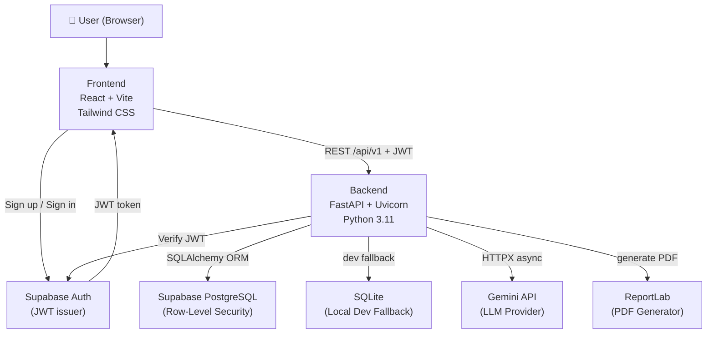
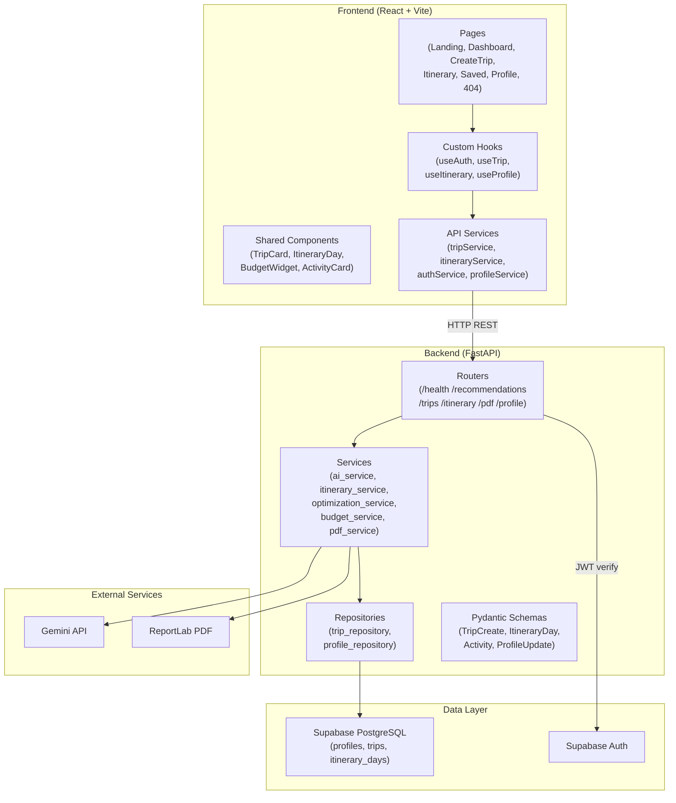
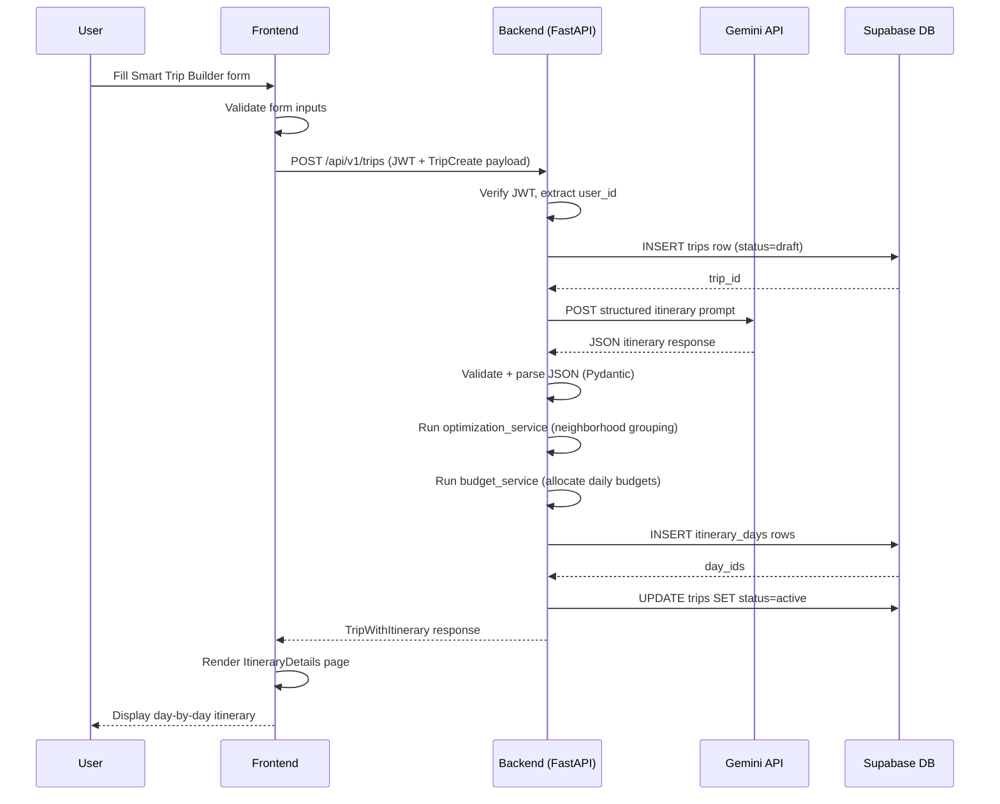
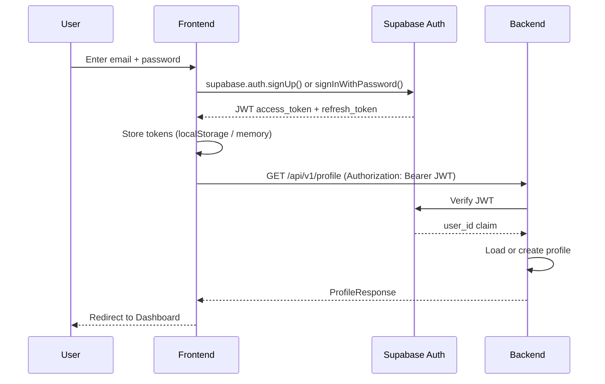
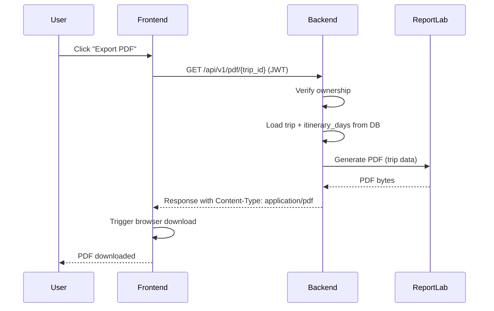
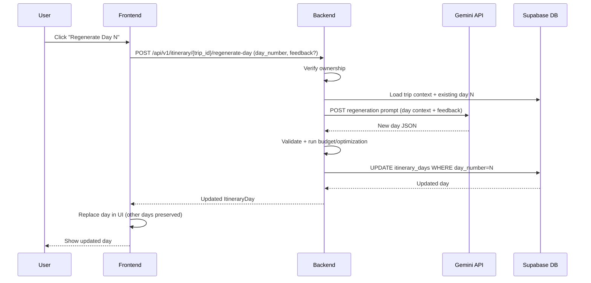

# Design Document: Personalized Travel Itinerary Planner

## Overview

The Personalized Travel Itinerary Planner is a full-stack, AI-powered web application that automates the creation of customized, day-by-day travel itineraries based on a rich set of user preferences including destination, budget, travel style, interests, and accessibility needs. Users can register, build trips through a guided form, receive AI-generated itineraries with route optimization and budget breakdowns, edit individual days or activities, export professional PDF travel guides, and manage saved trips from a personal dashboard.

The system is built as a monorepo with a React + Vite frontend, a Python FastAPI backend, and a Supabase-hosted PostgreSQL database. AI capabilities are provided through the Gemini API, with a deterministic mock provider for development and testing. Row-Level Security on all database tables and backend ownership checks ensure that users can only access their own data. The architecture is designed for horizontal scaling on the backend and CDN-hosted delivery of the frontend.

The application follows a clean separation of concerns: the frontend handles all user interaction and state presentation, the backend manages AI orchestration, data persistence, PDF generation, and business logic, and Supabase handles authentication tokens and database access with RLS policies enforced at the database level.

---

## Architecture

### System Context Diagram



### High-Level Architecture (Layered)



---

## Sequence Diagrams

### Trip Creation & Itinerary Generation Flow



### Authentication Flow



### PDF Export Flow



### Single-Day Regeneration Flow



---

## Components and Interfaces

### Frontend Pages

#### 1. LandingPage
**Purpose**: Marketing entry point — hero section, feature highlights, and CTA buttons  
**Route**: `/`  
**Key elements**: Hero with animated tagline, feature cards, testimonial section, Sign Up / Sign In CTAs

#### 2. SignUpPage / LoginPage
**Purpose**: Authentication forms with Supabase Auth integration  
**Routes**: `/signup`, `/login`  
**Key elements**: Email/password form, OAuth buttons, form validation, redirect after auth

#### 3. Dashboard
**Purpose**: Central hub showing recent trips, quick stats, and navigation  
**Route**: `/dashboard`  
**Key elements**: TripCard grid, "Create New Trip" CTA, budget summary widget

#### 4. CreateTripPage (Smart Trip Builder)
**Purpose**: Multi-step form for collecting all trip preferences  
**Route**: `/trips/new`  
**Key elements**: Step progress indicator, multi-step form sections, client-side validation, submit to generate itinerary

#### 5. DestinationRecommendationsPage
**Purpose**: AI-suggested destinations based on partial preferences  
**Route**: `/recommendations`  
**Key elements**: Preference quick-select, DestinationCard grid with AI reasoning blurbs

#### 6. ItineraryDetailsPage
**Purpose**: Full day-by-day itinerary view  
**Route**: `/trips/:tripId`  
**Key elements**: DayPanel accordion, ActivityCard list, BudgetWidget, map embed, PDF export button, edit mode toggle

#### 7. EditItineraryInterface
**Purpose**: Inline editing of activities within ItineraryDetailsPage  
**Route**: `/trips/:tripId/edit`  
**Key elements**: Drag-and-drop activity reordering, activity replacement modal, single-day regeneration trigger

#### 8. SavedTripsPage
**Purpose**: List of all saved trips with filter/sort  
**Route**: `/trips`  
**Key elements**: TripCard list, status filter (draft/active/completed), delete confirmation modal

#### 9. ProfilePage
**Purpose**: User profile management and saved preferences  
**Route**: `/profile`  
**Key elements**: Display name form, dietary preferences multi-select, accessibility toggles, default preferences

#### 10. NotFoundPage
**Purpose**: 404 fallback  
**Route**: `*`

---

### Frontend Component Interfaces

```javascript
// TripCard component
// Props:
// - trip: TripSummary
// - onDelete: (tripId: string) => void
// - onOpen: (tripId: string) => void

// ActivityCard component
// Props:
// - activity: Activity
// - onReplace: (activity: Activity) => void
// - editable: boolean

// BudgetWidget component
// Props:
// - dailyBudgets: DailyBudget[]
// - totalBudget: number
// - currency: string

// DayPanel component
// Props:
// - day: ItineraryDay
// - dayNumber: number
// - onRegenerate: (dayNumber: number, feedback?: string) => void
// - editable: boolean
```

---

### Backend Routers (FastAPI)

```python
# Router: /api/v1/health
# GET /api/v1/health
# Response: {"status": "ok", "version": "1.0.0"}

# Router: /api/v1/recommendations
# POST /api/v1/recommendations
# Body: RecommendationRequest
# Response: RecommendationResponse
# Auth: Required (JWT)

# Router: /api/v1/trips
# POST   /api/v1/trips                 → Create trip + generate itinerary
# GET    /api/v1/trips                 → List user's trips
# GET    /api/v1/trips/{trip_id}       → Get trip with itinerary
# PUT    /api/v1/trips/{trip_id}       → Update trip metadata
# DELETE /api/v1/trips/{trip_id}       → Delete trip + itinerary days
# Auth: Required (JWT)

# Router: /api/v1/itinerary
# PUT  /api/v1/itinerary/{trip_id}/days/{day_number}          → Update single day
# POST /api/v1/itinerary/{trip_id}/regenerate-day             → AI-regenerate one day
# PUT  /api/v1/itinerary/{trip_id}/days/{day_number}/activities → Reorder activities

# Router: /api/v1/pdf
# GET /api/v1/pdf/{trip_id}   → Export PDF
# Auth: Required (JWT)

# Router: /api/v1/profile
# GET /api/v1/profile         → Get current user's profile
# PUT /api/v1/profile         → Update profile + preferences
# Auth: Required (JWT)
```

---

## Data Models

### Frontend Types (JavaScript/TypeScript-style JSDoc)

```javascript
/**
 * @typedef {Object} TripPreferences
 * @property {string} destination
 * @property {string} start_date             - ISO 8601 date
 * @property {string} end_date               - ISO 8601 date
 * @property {number} budget                 - Total budget in USD
 * @property {number} travelers              - Number of travelers
 * @property {'solo'|'couple'|'family'|'friends'} travel_type
 * @property {'relaxed'|'moderate'|'fast-paced'} travel_pace
 * @property {string[]} interests            - e.g. ['food', 'history', 'nature']
 * @property {string} accommodation_pref     - e.g. 'hotel', 'hostel', 'airbnb'
 * @property {string[]} dietary_preferences  - e.g. ['vegetarian', 'halal']
 * @property {string[]} accessibility_needs  - e.g. ['wheelchair', 'elevator']
 */

/**
 * @typedef {Object} Activity
 * @property {string} id
 * @property {string} name
 * @property {string} description
 * @property {string} location
 * @property {string} start_time             - HH:MM
 * @property {string} end_time               - HH:MM
 * @property {number} estimated_cost
 * @property {string} category               - e.g. 'food', 'sightseeing', 'transport'
 * @property {string} [booking_url]
 * @property {string} [neighborhood]
 */

/**
 * @typedef {Object} ItineraryDay
 * @property {string} id
 * @property {string} trip_id
 * @property {number} day_number
 * @property {string} date                   - ISO 8601
 * @property {string} theme                  - e.g. 'Historical Downtown & Food Tour'
 * @property {Activity[]} activities
 * @property {number} daily_budget
 */

/**
 * @typedef {Object} Trip
 * @property {string} id
 * @property {string} user_id
 * @property {string} title
 * @property {TripPreferences} preferences
 * @property {'draft'|'active'|'completed'} status
 * @property {ItineraryDay[]} itinerary_days
 * @property {string} created_at
 * @property {string} updated_at
 */
```

### Backend Pydantic Schemas

```python
from pydantic import BaseModel, Field
from typing import Optional, Literal
from datetime import date


class ActivitySchema(BaseModel):
    id: str
    name: str
    description: str
    location: str
    start_time: str                          # "HH:MM"
    end_time: str                            # "HH:MM"
    estimated_cost: float = Field(ge=0)
    category: str
    booking_url: Optional[str] = None
    neighborhood: Optional[str] = None


class ItineraryDaySchema(BaseModel):
    id: str
    trip_id: str
    day_number: int = Field(ge=1)
    date: date
    theme: str
    activities: list[ActivitySchema]
    daily_budget: float = Field(ge=0)


class TripCreate(BaseModel):
    destination: str = Field(min_length=2, max_length=200)
    start_date: date
    end_date: date
    budget: float = Field(gt=0)
    travelers: int = Field(ge=1, le=50)
    travel_type: Literal["solo", "couple", "family", "friends"]
    travel_pace: Literal["relaxed", "moderate", "fast-paced"]
    interests: list[str] = Field(min_length=1)
    accommodation_pref: str
    dietary_preferences: list[str] = []
    accessibility_needs: list[str] = []


class TripResponse(BaseModel):
    id: str
    user_id: str
    title: str
    destination: str
    status: Literal["draft", "active", "completed"]
    preferences: dict
    itinerary_days: list[ItineraryDaySchema] = []
    created_at: str
    updated_at: str


class ProfileUpdate(BaseModel):
    display_name: Optional[str] = Field(None, max_length=100)
    dietary_preferences: list[str] = []
    accessibility_needs: list[str] = []
    default_travel_type: Optional[str] = None
    default_travel_pace: Optional[str] = None


class RecommendationRequest(BaseModel):
    interests: list[str]
    travel_type: str
    budget_range: str                        # "budget", "mid-range", "luxury"
    trip_duration_days: int = Field(ge=1)


class RecommendationResponse(BaseModel):
    destinations: list[dict]                 # [{name, country, reasoning, image_url}]
```

### Database Schema (PostgreSQL / Supabase)

```sql
-- profiles table
CREATE TABLE profiles (
    id          UUID PRIMARY KEY REFERENCES auth.users(id) ON DELETE CASCADE,
    display_name TEXT,
    preferences JSONB NOT NULL DEFAULT '{}',
    created_at  TIMESTAMPTZ NOT NULL DEFAULT NOW(),
    updated_at  TIMESTAMPTZ NOT NULL DEFAULT NOW()
);

-- trips table
CREATE TABLE trips (
    id          UUID PRIMARY KEY DEFAULT gen_random_uuid(),
    user_id     UUID NOT NULL REFERENCES auth.users(id) ON DELETE CASCADE,
    title       TEXT NOT NULL,
    destination TEXT NOT NULL,
    start_date  DATE NOT NULL,
    end_date    DATE NOT NULL,
    duration    INT NOT NULL,               -- end_date - start_date in days
    travelers   INT NOT NULL CHECK (travelers >= 1),
    budget      NUMERIC(12, 2) NOT NULL,
    interests   TEXT[] NOT NULL DEFAULT '{}',
    preferences JSONB NOT NULL DEFAULT '{}',
    status      TEXT NOT NULL DEFAULT 'draft' CHECK (status IN ('draft','active','completed')),
    created_at  TIMESTAMPTZ NOT NULL DEFAULT NOW(),
    updated_at  TIMESTAMPTZ NOT NULL DEFAULT NOW()
);

-- itinerary_days table
CREATE TABLE itinerary_days (
    id           UUID PRIMARY KEY DEFAULT gen_random_uuid(),
    trip_id      UUID NOT NULL REFERENCES trips(id) ON DELETE CASCADE,
    day_number   INT NOT NULL CHECK (day_number >= 1),
    date         DATE NOT NULL,
    theme        TEXT NOT NULL,
    activities   JSONB NOT NULL DEFAULT '[]',  -- array of ActivitySchema
    daily_budget NUMERIC(12, 2) NOT NULL DEFAULT 0,
    created_at   TIMESTAMPTZ NOT NULL DEFAULT NOW(),
    updated_at   TIMESTAMPTZ NOT NULL DEFAULT NOW(),
    UNIQUE (trip_id, day_number)
);

-- Row-Level Security
ALTER TABLE profiles ENABLE ROW LEVEL SECURITY;
ALTER TABLE trips ENABLE ROW LEVEL SECURITY;
ALTER TABLE itinerary_days ENABLE ROW LEVEL SECURITY;

CREATE POLICY "Users access own profile"
    ON profiles FOR ALL USING (auth.uid() = id);

CREATE POLICY "Users access own trips"
    ON trips FOR ALL USING (auth.uid() = user_id);

CREATE POLICY "Users access own itinerary days"
    ON itinerary_days FOR ALL
    USING (trip_id IN (SELECT id FROM trips WHERE user_id = auth.uid()));

-- Indexes
CREATE INDEX idx_trips_user_id ON trips(user_id);
CREATE INDEX idx_itinerary_days_trip_id ON itinerary_days(trip_id);
```

---

## Algorithmic Pseudocode

### Main Itinerary Generation Algorithm

```python
ALGORITHM generate_itinerary(trip_create: TripCreate, user_id: str) -> TripResponse:
    """
    Preconditions:
      - trip_create is validated by Pydantic (all fields present and within bounds)
      - user_id is a verified JWT sub claim (not empty)
      - start_date <= end_date
      - budget > 0, travelers >= 1

    Postconditions:
      - Returns TripResponse with status='active'
      - len(itinerary_days) == trip_create.duration_days
      - sum(day.daily_budget for day in itinerary_days) <= trip_create.budget
      - Each day has at least 1 activity

    Loop Invariants:
      - After processing day N, days 1..N are fully populated and budget-allocated
    """

    # Step 1: Persist draft trip
    duration_days = (trip_create.end_date - trip_create.start_date).days + 1
    trip = await trip_repository.create(trip_create, user_id, status="draft")

    # Step 2: Build AI prompt
    prompt = build_itinerary_prompt(trip_create, duration_days)

    # Step 3: Call AI service with retry
    raw_json = await ai_service.generate(prompt, response_schema=ITINERARY_JSON_SCHEMA)

    # Step 4: Validate AI response
    itinerary_data = validate_itinerary_json(raw_json, expected_days=duration_days)

    # Step 5: Route/neighborhood optimization
    itinerary_data = optimization_service.group_by_neighborhood(itinerary_data)

    # Step 6: Budget allocation
    itinerary_data = budget_service.allocate(
        itinerary_data, total_budget=trip_create.budget, travelers=trip_create.travelers
    )

    # Step 7: Persist itinerary days
    days = []
    FOR day_number, day_data IN enumerate(itinerary_data["days"], start=1):
        ASSERT day_data["activities"] is not empty
        day = await trip_repository.create_day(trip.id, day_number, day_data)
        days.append(day)
    END FOR

    # Step 8: Activate trip
    await trip_repository.update_status(trip.id, "active")

    RETURN TripResponse(trip=trip, itinerary_days=days)
```

### AI Prompt Builder

```python
ALGORITHM build_itinerary_prompt(trip: TripCreate, duration_days: int) -> str:
    """
    Preconditions:
      - trip is a valid TripCreate instance
      - duration_days >= 1

    Postconditions:
      - Returns a non-empty string prompt
      - Prompt instructs AI to return valid JSON matching ITINERARY_JSON_SCHEMA
      - Prompt includes all user preferences
    """

    interests_str = ", ".join(trip.interests)
    dietary_str   = ", ".join(trip.dietary_preferences) if trip.dietary_preferences else "none"
    access_str    = ", ".join(trip.accessibility_needs) if trip.accessibility_needs else "none"

    prompt = f"""
    You are a professional travel planner. Generate a detailed {duration_days}-day itinerary
    for {trip.destination}.

    Trip details:
    - Travel type: {trip.travel_type}
    - Pace: {trip.travel_pace}
    - Total budget: ${trip.budget} USD for {trip.travelers} traveler(s)
    - Interests: {interests_str}
    - Accommodation: {trip.accommodation_pref}
    - Dietary preferences: {dietary_str}
    - Accessibility needs: {access_str}

    Return ONLY a JSON object matching this schema:
    {ITINERARY_JSON_SCHEMA}

    Rules:
    - Group activities by neighborhood to minimize travel time
    - Respect the daily budget derived from total budget / {duration_days}
    - Each day must have a descriptive theme
    - Include estimated_cost for every activity
    - Time activities so they don't overlap (HH:MM format)
    - Consider meal times based on dietary preferences
    - Flag activities that may have accessibility concerns
    """

    RETURN prompt
```

### Neighborhood Grouping (Optimization Service)

```python
ALGORITHM group_by_neighborhood(itinerary_data: dict) -> dict:
    """
    Preconditions:
      - itinerary_data["days"] is a non-empty list
      - Each activity has a "neighborhood" or "location" field

    Postconditions:
      - Activities within each day are reordered to cluster by neighborhood
      - No activities are added or removed; only order changes
      - Time slots are re-assigned to reflect the new order

    Loop Invariants:
      - After processing day D, all activities in days 1..D are neighborhood-grouped
      - Total activity count per day remains unchanged
    """

    FOR each day IN itinerary_data["days"]:
        activities = day["activities"]

        # Group by neighborhood using a stable sort
        neighborhood_map = defaultdict(list)
        FOR activity IN activities:
            key = activity.get("neighborhood") or extract_neighborhood(activity["location"])
            neighborhood_map[key].append(activity)
        END FOR

        # Flatten grouped activities, preserving intra-group order
        ordered = []
        FOR neighborhood, group IN sorted(neighborhood_map.items()):
            ordered.extend(group)
        END FOR

        # Re-assign time slots preserving duration
        ordered = reassign_time_slots(ordered, day_start="09:00")

        day["activities"] = ordered
    END FOR

    RETURN itinerary_data


ALGORITHM reassign_time_slots(activities: list, day_start: str) -> list:
    """
    Preconditions:
      - activities is a non-empty list of activity dicts
      - day_start is in "HH:MM" format
      - Each activity has start_time and end_time

    Postconditions:
      - Activities are returned with consecutive non-overlapping time slots
      - Activity durations are preserved (end - start remains the same)
      - 15-minute travel buffer inserted between neighborhood switches
    """

    current_time = parse_time(day_start)
    prev_neighborhood = None

    FOR activity IN activities:
        duration = parse_time(activity["end_time"]) - parse_time(activity["start_time"])

        # Add travel buffer on neighborhood switch
        IF prev_neighborhood IS NOT None AND activity.neighborhood != prev_neighborhood:
            current_time += timedelta(minutes=15)
        END IF

        activity["start_time"] = format_time(current_time)
        activity["end_time"]   = format_time(current_time + duration)
        current_time           = current_time + duration

        prev_neighborhood = activity.neighborhood
    END FOR

    RETURN activities
```

### Budget Allocation Service

```python
ALGORITHM allocate_budget(itinerary_data: dict, total_budget: float, travelers: int) -> dict:
    """
    Preconditions:
      - total_budget > 0
      - travelers >= 1
      - itinerary_data["days"] is non-empty

    Postconditions:
      - Each day has a "daily_budget" field
      - sum(day.daily_budget for day in days) <= total_budget
      - Each activity has an adjusted "estimated_cost" (per traveler)

    Loop Invariants:
      - remaining_budget >= 0 after each day allocation
    """

    num_days = len(itinerary_data["days"])
    base_daily = total_budget / num_days

    # First pass: sum up AI-suggested costs per day
    day_costs = []
    FOR day IN itinerary_data["days"]:
        raw_cost = sum(a["estimated_cost"] for a in day["activities"]) * travelers
        day_costs.append(raw_cost)
    END FOR

    total_suggested = sum(day_costs)

    # Second pass: scale to fit total budget
    FOR i, day IN enumerate(itinerary_data["days"]):
        IF total_suggested > 0:
            scale = day_costs[i] / total_suggested
            day["daily_budget"] = round(total_budget * scale, 2)
        ELSE:
            day["daily_budget"] = round(base_daily, 2)
        END IF

        # Adjust individual activity costs proportionally
        IF day_costs[i] > 0:
            cost_scale = day["daily_budget"] / day_costs[i]
            FOR activity IN day["activities"]:
                activity["estimated_cost"] = round(
                    activity["estimated_cost"] * cost_scale, 2
                )
            END FOR
        END IF
    END FOR

    RETURN itinerary_data
```

### Single-Day Regeneration Algorithm

```python
ALGORITHM regenerate_day(
    trip_id: str, day_number: int, user_id: str, feedback: str | None
) -> ItineraryDaySchema:
    """
    Preconditions:
      - trip_id exists in DB and belongs to user_id
      - day_number is within 1..trip.duration_days
      - feedback is None or a non-empty string

    Postconditions:
      - Returns a new ItineraryDaySchema for the given day_number
      - Other days in the trip are unchanged in the database
      - New day's daily_budget respects original allocation
    """

    # Step 1: Ownership check
    trip = await trip_repository.get(trip_id)
    ASSERT trip.user_id == user_id, raise HTTPException(403)

    # Step 2: Load original day for context
    original_day = await trip_repository.get_day(trip_id, day_number)

    # Step 3: Build regeneration prompt
    prompt = build_regeneration_prompt(trip, day_number, original_day, feedback)

    # Step 4: AI call
    raw_json = await ai_service.generate(prompt, response_schema=SINGLE_DAY_SCHEMA)
    new_day_data = validate_single_day_json(raw_json)

    # Step 5: Optimize + budget for the single day
    new_day_data = optimization_service.group_by_neighborhood({"days": [new_day_data]})["days"][0]
    new_day_data["daily_budget"] = original_day.daily_budget  # preserve original allocation

    # Step 6: Persist (replace existing day)
    updated_day = await trip_repository.update_day(trip_id, day_number, new_day_data)

    RETURN updated_day
```

### JWT Verification Dependency (FastAPI)

```python
ALGORITHM verify_jwt(token: str = Depends(oauth2_scheme)) -> str:
    """
    Preconditions:
      - token is a non-empty Bearer token string

    Postconditions:
      - Returns user_id (sub claim) if token is valid and not expired
      - Raises HTTPException(401) for invalid or expired tokens

    Side Effects:
      - None (read-only verification against Supabase JWKS)
    """

    TRY:
        payload = jwt.decode(
            token,
            key=supabase_jwt_secret,
            algorithms=["HS256"],
            audience="authenticated"
        )
        user_id = payload.get("sub")
        IF user_id IS None:
            RAISE HTTPException(401, "Invalid token: missing sub claim")
        RETURN user_id
    EXCEPT JWTExpiredSignatureError:
        RAISE HTTPException(401, "Token has expired")
    EXCEPT JWTError:
        RAISE HTTPException(401, "Invalid token")
```

### AI Service with Retry and Mock Fallback

```python
ALGORITHM ai_service_generate(prompt: str, response_schema: dict) -> dict:
    """
    Preconditions:
      - prompt is a non-empty string
      - response_schema is a valid JSON schema dict

    Postconditions:
      - Returns dict matching response_schema structure
      - Raises AIServiceError after MAX_RETRIES attempts

    Loop Invariants:
      - attempt count increases by 1 each iteration
      - Each retry uses exponential backoff: delay = BASE_DELAY * 2^attempt
    """

    IF USE_MOCK_AI:
        RETURN mock_ai_provider.generate(response_schema)
    END IF

    MAX_RETRIES = 3
    BASE_DELAY  = 1.0

    FOR attempt IN range(MAX_RETRIES):
        TRY:
            response = await httpx_client.post(
                GEMINI_API_URL,
                json={"contents": [{"parts": [{"text": prompt}]}],
                      "generationConfig": {"responseMimeType": "application/json"}},
                headers={"x-goog-api-key": GEMINI_API_KEY},
                timeout=30.0
            )
            response.raise_for_status()
            raw_text = response.json()["candidates"][0]["content"]["parts"][0]["text"]
            parsed  = json.loads(raw_text)
            validate_against_schema(parsed, response_schema)
            RETURN parsed
        EXCEPT (httpx.HTTPStatusError, json.JSONDecodeError, ValidationError) AS e:
            IF attempt == MAX_RETRIES - 1:
                RAISE AIServiceError(f"AI generation failed after {MAX_RETRIES} attempts: {e}")
            await asyncio.sleep(BASE_DELAY * (2 ** attempt))
        END TRY
    END FOR
```

---

## Key Functions with Formal Specifications

### `trip_repository.create()`

```python
async def create(
    trip_create: TripCreate,
    user_id: str,
    status: str = "draft"
) -> TripRow:
    pass
```

**Preconditions:**
- `trip_create` passes Pydantic validation
- `user_id` is a valid UUID string from JWT sub claim
- `status` is one of `"draft"`, `"active"`, `"completed"`

**Postconditions:**
- A new row is inserted into the `trips` table
- Returns `TripRow` with auto-generated `id` and `created_at`
- `trip.user_id == user_id`
- `trip.status == status`

**Side Effects:**
- Writes to `trips` table; triggers `updated_at` default

---

### `pdf_service.generate_pdf()`

```python
def generate_pdf(trip: TripResponse) -> bytes:
    pass
```

**Preconditions:**
- `trip.itinerary_days` is non-empty
- `trip.destination` is a non-empty string
- All `ItineraryDay` objects have at least one activity

**Postconditions:**
- Returns a valid PDF byte stream
- PDF contains a cover page, per-day sections, and a budget summary
- File size is reasonable (< 10 MB for typical trips)

**Loop Invariants:**
- For each day processed, the PDF story list grows monotonically
- No day is skipped

---

### `budget_service.calculate_summary()`

```python
def calculate_summary(
    itinerary_days: list[ItineraryDaySchema],
    total_budget: float,
    travelers: int
) -> BudgetSummary:
    pass
```

**Preconditions:**
- `itinerary_days` is non-empty
- `total_budget > 0`
- `travelers >= 1`

**Postconditions:**
- Returns `BudgetSummary` with:
  - `total_spent <= total_budget`
  - `per_day` list has same length as `itinerary_days`
  - `per_person == total_spent / travelers`
- No mutations to input `itinerary_days`

---

### `optimization_service.extract_neighborhood()`

```python
def extract_neighborhood(location: str) -> str:
    pass
```

**Preconditions:**
- `location` is a non-empty string

**Postconditions:**
- Returns a non-empty string neighborhood label
- Deterministic: same `location` always returns same label
- Falls back to `"General"` if no neighborhood can be parsed

---

## Example Usage

### Frontend — Creating a Trip

```javascript
// tripService.js
const API_BASE = import.meta.env.VITE_API_BASE_URL + '/api/v1'

export async function createTrip(tripData, accessToken) {
  const response = await fetch(`${API_BASE}/trips`, {
    method: 'POST',
    headers: {
      'Content-Type': 'application/json',
      'Authorization': `Bearer ${accessToken}`,
    },
    body: JSON.stringify(tripData),
  })

  if (!response.ok) {
    const err = await response.json()
    throw new Error(err.detail || 'Failed to create trip')
  }

  return response.json() // TripResponse
}
```

### Frontend — Regenerating a Day

```javascript
// itineraryService.js
export async function regenerateDay(tripId, dayNumber, feedback, accessToken) {
  const response = await fetch(`${API_BASE}/itinerary/${tripId}/regenerate-day`, {
    method: 'POST',
    headers: {
      'Content-Type': 'application/json',
      'Authorization': `Bearer ${accessToken}`,
    },
    body: JSON.stringify({ day_number: dayNumber, feedback }),
  })

  if (!response.ok) throw new Error('Regeneration failed')
  return response.json() // ItineraryDay
}
```

### Backend — Trip Router

```python
# routers/trips.py
from fastapi import APIRouter, Depends, HTTPException
from ..schemas import TripCreate, TripResponse
from ..services.itinerary_service import generate_itinerary
from ..dependencies import verify_jwt

router = APIRouter(prefix="/api/v1/trips", tags=["trips"])

@router.post("/", response_model=TripResponse, status_code=201)
async def create_trip(
    trip_data: TripCreate,
    user_id: str = Depends(verify_jwt)
):
    try:
        return await generate_itinerary(trip_data, user_id)
    except AIServiceError as e:
        raise HTTPException(status_code=502, detail=str(e))
    except Exception as e:
        raise HTTPException(status_code=500, detail="Internal server error")

@router.get("/", response_model=list[TripResponse])
async def list_trips(user_id: str = Depends(verify_jwt)):
    return await trip_repository.list_by_user(user_id)

@router.get("/{trip_id}", response_model=TripResponse)
async def get_trip(trip_id: str, user_id: str = Depends(verify_jwt)):
    trip = await trip_repository.get(trip_id)
    if not trip or trip.user_id != user_id:
        raise HTTPException(status_code=404, detail="Trip not found")
    return trip

@router.delete("/{trip_id}", status_code=204)
async def delete_trip(trip_id: str, user_id: str = Depends(verify_jwt)):
    trip = await trip_repository.get(trip_id)
    if not trip or trip.user_id != user_id:
        raise HTTPException(status_code=404, detail="Trip not found")
    await trip_repository.delete(trip_id)
```

### Backend — PDF Generation

```python
# services/pdf_service.py
from reportlab.lib.pagesizes import A4
from reportlab.platypus import SimpleDocTemplate, Paragraph, Spacer, Table
from reportlab.lib.styles import getSampleStyleSheet
import io

def generate_pdf(trip: TripResponse) -> bytes:
    buffer = io.BytesIO()
    doc = SimpleDocTemplate(buffer, pagesize=A4)
    styles = getSampleStyleSheet()
    story = []

    # Cover
    story.append(Paragraph(trip.title, styles["Title"]))
    story.append(Paragraph(f"Destination: {trip.destination}", styles["Normal"]))
    story.append(Spacer(1, 20))

    # Days
    for day in trip.itinerary_days:
        story.append(Paragraph(f"Day {day.day_number}: {day.theme}", styles["Heading2"]))
        for activity in day.activities:
            story.append(Paragraph(
                f"{activity.start_time} - {activity.end_time}  {activity.name}",
                styles["Normal"]
            ))
            story.append(Paragraph(f"  ${activity.estimated_cost:.2f}", styles["Normal"]))
        story.append(Spacer(1, 12))

    # Budget summary
    total_spent = sum(d.daily_budget for d in trip.itinerary_days)
    story.append(Paragraph("Budget Summary", styles["Heading2"]))
    story.append(Paragraph(f"Total allocated: ${total_spent:.2f}", styles["Normal"]))

    doc.build(story)
    return buffer.getvalue()
```

---

## Correctness Properties

*A property is a characteristic or behavior that should hold true across all valid executions of a system — essentially, a formal statement about what the system should do. Properties serve as the bridge between human-readable specifications and machine-verifiable correctness guarantees.*

### Property 1: Budget Safety

*For any* generated itinerary with any positive total budget, any trip duration, and any number of travelers, the sum of all daily budgets must not exceed the user's stated total budget.

- `∀ trip: sum(day.daily_budget for day in trip.itinerary_days) ≤ trip.budget`

**Validates: Requirements 6.1**

---

### Property 2: Day Completeness

*For any* trip in `active` status, the number of `ItineraryDay` records must exactly equal the number of calendar days between `start_date` and `end_date` inclusive.

- `∀ trip with status="active": len(trip.itinerary_days) == (trip.end_date - trip.start_date).days + 1`

**Validates: Requirements 4.2**

---

### Property 3: Activity Non-Overlap

*For any* itinerary day, no two activities may have overlapping time slots after the Optimization_Service has processed the day.

- `∀ day, ∀ i ≠ j: activities[i].end_time ≤ activities[j].start_time OR activities[j].end_time ≤ activities[i].start_time`

**Validates: Requirements 5.3**

---

### Property 4: Ownership Isolation

*For any* read, write, or delete operation on a trip or itinerary day, the operation must only succeed when the requesting user's JWT sub claim matches the trip's `user_id`; otherwise the backend must return HTTP 404 or HTTP 403.

- `∀ operation(trip_id, user_id): trip.user_id ≠ user_id ⟹ response.status ∈ {403, 404}`

**Validates: Requirements 14.2, 8.2, 9.2, 9.3, 10.2**

---

### Property 5: Authentication Requirement

*For any* request to a non-health backend endpoint with a missing, malformed, or expired JWT, the backend must return HTTP 401.

- `∀ request to /api/v1/{endpoint ≠ health}: (absent|invalid|expired JWT) ⟹ response.status == 401`

**Validates: Requirements 1.10, 14.1**

---

### Property 6: Regeneration Isolation

*For any* trip with D itinerary days, regenerating day N must leave every other day (all days where `day_number ≠ N`) bit-identical in the database before and after the operation.

- `∀ regenerate(trip_id, N): ∀ day IN trip.itinerary_days WHERE day.day_number ≠ N: day unchanged`

**Validates: Requirements 8.5**

---

### Property 7: PDF Completeness

*For any* trip, the number of day sections in the generated PDF must equal the number of `ItineraryDay` records in that trip, and the PDF must not exceed 10 MB for trips up to 30 days.

- `∀ trip: pdf_section_count(generate_pdf(trip)) == len(trip.itinerary_days)`
- `∀ trip with len(itinerary_days) ≤ 30: len(generate_pdf(trip)) < 10 * 1024 * 1024`

**Validates: Requirements 10.4, 10.5**

---

### Property 8: Optimization Preserves Activity Count

*For any* itinerary day, the Optimization_Service must return the same number of activities it received — no activities may be added or removed during neighborhood grouping or time-slot reassignment.

- `∀ day: len(optimize(day).activities) == len(day.activities)`

**Validates: Requirements 5.2**

---

### Property 9: Neighborhood Contiguity

*For any* list of activities with neighborhood labels, after the Optimization_Service processes the day, all activities that share a neighborhood label must appear as a contiguous block.

- `∀ day after optimization: ∀ neighborhood k: activities with k form a contiguous subsequence`

**Validates: Requirements 5.1**

---

### Property 10: Optimization Determinism

*For any* activity list and any `day_start` time, calling the Optimization_Service twice with identical inputs must produce identical output.

- `∀ activities, day_start: optimize(activities, day_start) == optimize(activities, day_start)`

**Validates: Requirements 5.6**

---

### Property 11: Budget Allocation Activity-Cost Consistency

*For any* allocated itinerary day, the sum of all activity `estimated_cost` values within that day must equal the day's `daily_budget` (within floating-point tolerance of 0.01).

- `∀ day after allocation: |sum(a.estimated_cost for a in day.activities) - day.daily_budget| ≤ 0.01`

**Validates: Requirements 6.2**

---

### Property 12: Unauthenticated Route Redirect

*For any* protected route in the Frontend (Dashboard, CreateTrip, ItineraryDetails, EditItinerary, SavedTrips, Profile), accessing it without a valid JWT must result in a redirect to `/login`.

- `∀ protected_route: unauthenticated_access ⟹ redirect to /login`

**Validates: Requirements 1.9, 13.11**

---

### Property 13: Form Validation Rejects Whitespace-Only Inputs

*For any* required SmartTripForm field, a string composed entirely of whitespace characters must be treated as empty, rejected with an inline validation error, and must not trigger an API call.

**Validates: Requirements 1.4, 2.3**

---

### Property 14: Prompt Completeness

*For any* valid `TripCreate` payload, the string returned by `build_itinerary_prompt` must contain all user preference fields: destination, travel type, pace, total budget, number of travelers, all interests, accommodation preference, all dietary preferences, and all accessibility needs.

**Validates: Requirements 4.4**

---

### Property 15: Regeneration Preserves Budget Allocation

*For any* regeneration of day N in any trip, the `daily_budget` value of the returned regenerated day must equal the `daily_budget` of the original day N before regeneration.

- `∀ regenerate(trip_id, N): result.daily_budget == original_day_N.daily_budget`

**Validates: Requirements 8.4**

---

### Property 16: Trip Deletion Cascade

*For any* trip that is deleted via `DELETE /api/v1/trips/{trip_id}`, all associated `itinerary_days` rows for that trip must also be removed from the database; no orphan records may remain.

- `∀ delete(trip_id): ∀ day WHERE day.trip_id == trip_id: day NOT IN database`

**Validates: Requirements 9.4**

---

### Property 17: Profile Update Round-Trip

*For any* valid `ProfileUpdate` payload, after a successful `PUT /api/v1/profile`, a subsequent `GET /api/v1/profile` must return values that are equivalent to the submitted update.

- `∀ update: GET(profile) after PUT(profile, update) ≡ update`

**Validates: Requirements 11.3**

---

### Property 18: Orphan Cleanup on Failed Generation

*For any* trip creation that fails after all AI retries are exhausted, no `Trip` row with `status=draft` for that generation attempt may remain in the database.

- `∀ failed_generate(user_id): trip_id NOT IN database after failure`

**Validates: Requirements 15.4, 4.5**

---

## Error Handling

### Error Scenario 1: AI Service Timeout or Rate Limit

**Condition**: Gemini API returns HTTP 429 or request times out after 30s  
**Response**: Backend retries up to 3 times with exponential backoff (1s, 2s, 4s)  
**Recovery**: After 3 failures, returns HTTP 502 to frontend with `{"detail": "AI service temporarily unavailable. Please try again."}`  
**Frontend**: Displays retry banner; does not lose form data

### Error Scenario 2: AI Returns Malformed JSON

**Condition**: Gemini returns text that is not valid JSON or fails Pydantic schema validation  
**Response**: Backend logs the raw response, retries the prompt with an explicit correction instruction appended  
**Recovery**: If all retries fail, returns HTTP 502; trip row is deleted (draft cleanup)  
**Frontend**: Shows user-friendly error message

### Error Scenario 3: Unauthorized Trip Access

**Condition**: User requests `GET /api/v1/trips/{trip_id}` for a trip owned by another user  
**Response**: Backend returns HTTP 404 (not 403, to avoid leaking existence)  
**Recovery**: None required; access denied silently

### Error Scenario 4: JWT Expired During Session

**Condition**: User's JWT expires mid-session  
**Response**: Backend returns HTTP 401  
**Frontend**: Supabase client auto-refreshes using refresh token; if refresh fails, redirects to `/login`

### Error Scenario 5: Form Validation Failure

**Condition**: User submits SmartTripBuilder with missing required fields or invalid dates  
**Response**: Frontend validates before submission and shows inline field errors  
**Recovery**: User corrects fields; no backend call is made until validation passes

### Error Scenario 6: Database Connection Failure

**Condition**: Supabase PostgreSQL is unreachable  
**Response**: Backend returns HTTP 503  
**Recovery**: Application falls back to SQLite in local development; in production, surfaces a maintenance banner

---

## Testing Strategy

### Unit Testing Approach

Each backend service and utility function is unit-tested in isolation using `pytest` and `unittest.mock`.

Key unit test targets:
- `budget_service.allocate()` — assert budget sum ≤ total_budget for various input sizes
- `optimization_service.group_by_neighborhood()` — assert same activities, different order, no duplicates
- `build_itinerary_prompt()` — assert all user preferences appear in output string
- `reassign_time_slots()` — assert no overlapping slots after re-assignment
- `verify_jwt()` — assert 401 on expired/tampered tokens, user_id returned on valid token

Frontend unit tests use Vitest + React Testing Library:
- Form validation logic in `CreateTripPage`
- `BudgetWidget` renders correct totals
- `DayPanel` calls `onRegenerate` with correct args

### Property-Based Testing Approach

**Property Test Library**: `hypothesis` (Python backend), `fast-check` (JavaScript frontend)

Backend property tests:
```python
from hypothesis import given, strategies as st

@given(
    total_budget=st.floats(min_value=100, max_value=100000),
    num_days=st.integers(min_value=1, max_value=30),
    num_travelers=st.integers(min_value=1, max_value=20)
)
def test_budget_allocation_never_exceeds_total(total_budget, num_days, num_travelers):
    itinerary = generate_mock_itinerary(num_days)
    result = budget_service.allocate(itinerary, total_budget, num_travelers)
    total = sum(day["daily_budget"] for day in result["days"])
    assert total <= total_budget + 0.01  # floating point tolerance
```

Frontend property tests:
```javascript
// fast-check: reassign_time_slots never produces overlapping activities
fc.assert(fc.property(
  fc.array(fc.record({ start_time: fc.string(), end_time: fc.string() }), { minLength: 1 }),
  (activities) => {
    const result = reassignTimeSlots(activities, '09:00')
    for (let i = 1; i < result.length; i++) {
      expect(parseTime(result[i].start_time)).toBeGreaterThanOrEqual(parseTime(result[i-1].end_time))
    }
  }
))
```

### Integration Testing Approach

- FastAPI `TestClient` used for end-to-end router tests with a test Supabase project or SQLite
- Mock Gemini provider (`USE_MOCK_AI=true`) returns deterministic JSON responses
- Integration tests cover the full create-trip → generate-itinerary → export-PDF flow
- Auth integration tests use a test Supabase JWT signed with the test secret

---

## Performance Considerations

- **AI Latency**: Gemini API calls take 3–10 seconds. The backend streams progress status via a polling endpoint (`GET /api/v1/trips/{id}/status`) so the frontend can show a progress indicator rather than a blank wait.
- **Database Queries**: `itinerary_days` are loaded with `SELECT *` for the trip detail page. For large trips (30+ days), this is acceptable. The `activities` JSONB column is loaded in bulk; no N+1 queries.
- **PDF Generation**: ReportLab runs synchronously in a thread pool executor (`asyncio.run_in_executor`) to avoid blocking the FastAPI event loop.
- **Frontend Bundle**: Vite tree-shaking keeps the bundle lean. Lucide icons are imported individually. React Router enables code-splitting per page.
- **Caching**: Destination recommendations (which change infrequently) can be cached in-memory with a 1-hour TTL using `functools.lru_cache` or a simple dict cache keyed by interest hash.

---

## Security Considerations

- **JWT Verification**: All `/api/v1` endpoints (except `/health`) verify the Supabase JWT on every request. The JWT secret is loaded from the `SUPABASE_JWT_SECRET` environment variable — never hard-coded.
- **Row-Level Security**: Supabase RLS policies ensure that even if the backend has a bug, the database itself rejects cross-user data access. The service role key is never exposed to the frontend.
- **Input Sanitization**: All user inputs pass through Pydantic validation before reaching services. SQL injection is mitigated by SQLAlchemy's parameterized queries. The AI prompt uses f-string interpolation of already-validated Pydantic fields only.
- **Secrets Management**: All credentials (`SUPABASE_URL`, `SUPABASE_ANON_KEY`, `GEMINI_API_KEY`) are loaded from `.env` files. The `.env` file is listed in `.gitignore`. Frontend only receives the `SUPABASE_ANON_KEY` (safe for client use) via `VITE_` prefixed env vars.
- **CORS**: FastAPI `CORSMiddleware` is configured to allow only the known frontend origin in production.
- **Rate Limiting**: A lightweight rate limiter (e.g., `slowapi`) is applied to AI-heavy endpoints to prevent abuse.
- **Ownership Checks**: Every write operation (update, delete, PDF export) performs an explicit `trip.user_id == user_id` check before proceeding, in addition to RLS.

---

## Project Structure

```
personalized-travel-planner/
├── README.md
├── frontend/
│   ├── index.html
│   ├── vite.config.js
│   ├── package.json
│   ├── tailwind.config.js
│   ├── src/
│   │   ├── main.jsx
│   │   ├── App.jsx
│   │   ├── pages/
│   │   │   ├── LandingPage.jsx
│   │   │   ├── LoginPage.jsx
│   │   │   ├── SignUpPage.jsx
│   │   │   ├── Dashboard.jsx
│   │   │   ├── CreateTripPage.jsx
│   │   │   ├── RecommendationsPage.jsx
│   │   │   ├── ItineraryDetailsPage.jsx
│   │   │   ├── SavedTripsPage.jsx
│   │   │   ├── ProfilePage.jsx
│   │   │   └── NotFoundPage.jsx
│   │   ├── components/
│   │   │   ├── TripCard.jsx
│   │   │   ├── ActivityCard.jsx
│   │   │   ├── DayPanel.jsx
│   │   │   ├── BudgetWidget.jsx
│   │   │   ├── SmartTripForm/
│   │   │   │   ├── StepIndicator.jsx
│   │   │   │   ├── StepDestination.jsx
│   │   │   │   ├── StepDates.jsx
│   │   │   │   ├── StepPreferences.jsx
│   │   │   │   └── StepReview.jsx
│   │   │   └── shared/
│   │   │       ├── Navbar.jsx
│   │   │       ├── LoadingSpinner.jsx
│   │   │       └── ErrorBanner.jsx
│   │   ├── hooks/
│   │   │   ├── useAuth.js
│   │   │   ├── useTrip.js
│   │   │   ├── useItinerary.js
│   │   │   └── useProfile.js
│   │   ├── services/
│   │   │   ├── authService.js
│   │   │   ├── tripService.js
│   │   │   ├── itineraryService.js
│   │   │   └── profileService.js
│   │   └── lib/
│   │       ├── supabaseClient.js
│   │       └── utils.js
├── backend/
│   ├── main.py
│   ├── requirements.txt
│   ├── .env.example
│   ├── app/
│   │   ├── __init__.py
│   │   ├── dependencies.py              # verify_jwt, get_db
│   │   ├── schemas.py                   # All Pydantic schemas
│   │   ├── models.py                    # SQLAlchemy ORM models
│   │   ├── database.py                  # Engine + session setup
│   │   ├── routers/
│   │   │   ├── health.py
│   │   │   ├── trips.py
│   │   │   ├── itinerary.py
│   │   │   ├── recommendations.py
│   │   │   ├── pdf.py
│   │   │   └── profile.py
│   │   ├── services/
│   │   │   ├── ai_service.py
│   │   │   ├── itinerary_service.py
│   │   │   ├── optimization_service.py
│   │   │   ├── budget_service.py
│   │   │   └── pdf_service.py
│   │   └── repositories/
│   │       ├── trip_repository.py
│   │       └── profile_repository.py
├── supabase/
│   ├── schema.sql
│   └── migrations/
│       └── 001_initial.sql
└── docs/
    ├── architecture.md
    ├── api.md
    └── deployment.md
```

---

## Dependencies

### Frontend
| Package | Version | Purpose |
|---|---|---|
| react | ^18.x | UI framework |
| react-dom | ^18.x | DOM rendering |
| react-router-dom | ^6.x | Client-side routing |
| vite | ^5.x | Build tool + dev server |
| tailwindcss | ^3.x | Utility-first CSS |
| lucide-react | latest | Icon library |
| @supabase/supabase-js | ^2.x | Supabase Auth + client |
| axios | ^1.x | HTTP client (alternative to fetch) |

### Backend
| Package | Version | Purpose |
|---|---|---|
| fastapi | ^0.111 | Web framework |
| uvicorn[standard] | ^0.29 | ASGI server |
| pydantic | ^2.x | Data validation |
| sqlalchemy | ^2.x | ORM |
| httpx | ^0.27 | Async HTTP client (Gemini calls) |
| python-jose[cryptography] | ^3.x | JWT decoding |
| reportlab | ^4.x | PDF generation |
| hypothesis | ^6.x | Property-based testing |
| pytest | ^8.x | Test runner |
| pytest-asyncio | ^0.23 | Async test support |
| python-dotenv | ^1.x | .env file loading |
| slowapi | ^0.1 | Rate limiting |
| aiosqlite | ^0.20 | Async SQLite (local dev fallback) |
